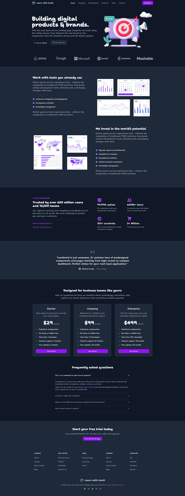

# Agency Landing Page

This is a submission to the [Assignment 01, Batch 03: Agency Landing Page](https://learnwithsumit.com/rnext/courses/rnext/assignment-1-requirements-batch-3-agency-landing-page) assignment.

## Table of contents

- [Overview](#overview)
  - [Requirements](#requirements)
  - [Screenshot](#screenshot)
  - [Links](#links)
- [My process](#my-process)
  - [Built with](#built-with)
  - [What I learned](#what-i-learned)
  - [Useful resources](#useful-resources)
- [Author](#author)

## Overview

### Requirements

- First, navigate to a folder and create a new React project using the command `npm create vite@latest`.
- Install Tailwind CSS in your newly created React project. **Remember** to use Tailwind version 4. You can follow the steps from point 2 in this documentation link for installing version 4.
- If Tailwind CSS is installed correctly and is working properly in your React project, then you need to create React components from the code in our provided `index.html` file.
- When creating components, each section, i.e., Header Section, Hero, Services, and all other sections, must be broken down into separate components. For example, the `Header.jsx` component file should only contain the code related to the Header. However, it's not just these components; you need to carefully consider the entire project and create small, reusable components.
- You need to create reusable components throughout the entire project. For example, within the Service sections, there is a section titled "Trusted Worldwide." On the right side of that section, you can see four options: "99.99% uptime," "600M+ Users," "100+ countries," and "5+ Million." Here, you need to create a reusable component. This means there will be only one component, but you will render it in different ways by passing Props. This is similar to sending different values to the Square component as shown in lesson 1.13. In your assignment, you will need to pass the title, description, and icon name to the component. There is scope for creating such reusable components in almost every section. You need to understand these and complete the assigned tasks.
- There are many `<svg>` tags in our provided `index.html` file. You need to create a separate component for each `<svg>`. For example, if an SVG code contains the icon for Google, GitHub, or a Shopping Cart, you will copy that `<svg>...</svg>` part, place it in a new component, and that component will return the SVG code. Then, in your React project, instead of writing `<svg>...</svg>` directly, you will use that component. For example, instead of `<svg>...</svg>`, you will write `<GoogleIcon />`.

### Screenshot

## My process

### Built with

- [React](https://react.dev/) - JS library
- [TailwindCSS](https://tailwindcss.com/) - For styles

### What I learned

- Creating reusable components and passing props to customize component

### Useful resources

- [HTML to JSX](https://transform.tools/html-to-jsx) - This helped me for converting HTML to JSX
