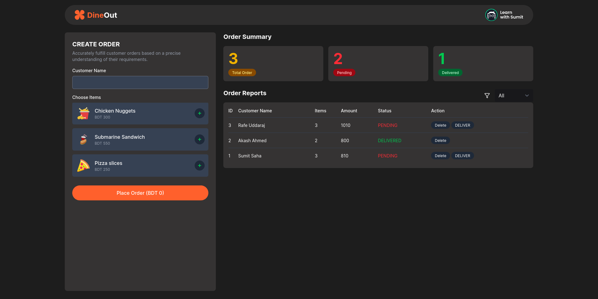
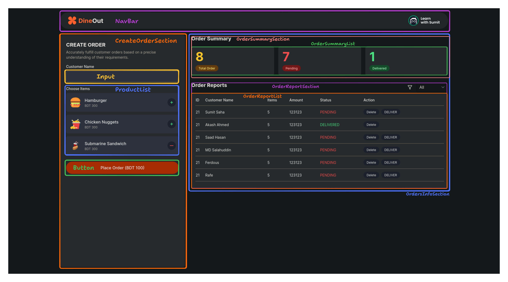
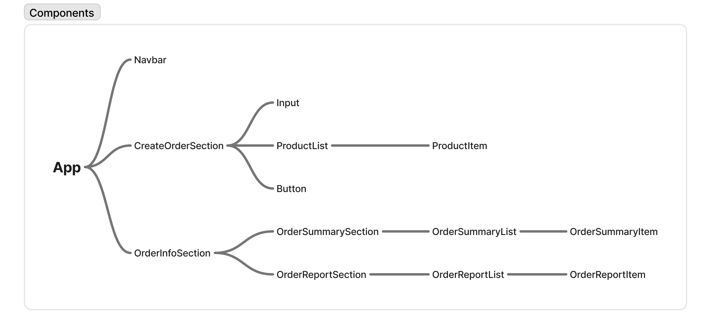

# Reactive Accelerator - Dine Out

This is a submission to the [Dine Out assignment on Reactive Accelerator](https://learnwithsumit.com/rnext/courses/rnext/assignment-2-requirements-batch-3-dine-out).

## Table of contents

- [Overview](#overview)
  - [Installation](#installation)
  - [Requirements](#requirements)
  - [Screenshot](#screenshot)
  - [Links](#links)
- [My process](#my-process)
  - [Built with](#built-with)
  - [Development Steps](#development-steps)
  - [What I learned](#what-i-learned)

## Overview

### Installation

- Clone the repository

  ```bash
  git clone repo_url
  ```

- Navigate to the project directory

  ```bash
  cd path_to_project
  ```

- Install all the dependencies

  ```bash
  npm i
  ```

- Launch the development server

  ```bash
  npm run dev
  ```

### Requirements

- Like the previous assignment, create a new React project using the npm create vite@latest command and install Tailwind CSS there. After that, convert the code from the index.html file we provided into React.
- On the left side, there is a "CREATE ORDER" form where new orders can be created for users. The form will include the customer's name and food item names.
- Within the items, you can render food names, images, and prices as you wish. Relevant food icons need to be downloaded and displayed.
- For whichever food items the user clicks the Plus (+) button, the total bill amount for the user should be displayed on the "Place Order" button based on the price. When the Minus (-) button is clicked, the total bill amount should be calculated and displayed.
- When an order is submitted, it will be added to the Order Reports section on the right side, and the order quantity in the Order Summary section above will be updated.
- In the Order Reports list, each order will initially have Deliver and Delete buttons next to it. When the Deliver button is clicked, the status of that order in Order Reports will change from Pending to Delivered, and the Deliver button will no longer be there. Simultaneously, one order will decrease from the Pending card in the Order Summary, and one order will increase in Delivered.
- Clicking the Delete button will remove that order from the list, and the summary section will be updated.
- The order list can be filtered based on status: All, Pending, Delivered. Only the orders with the status selected by the user will be displayed.

### Screenshot



### Links

- Solution URL: [GitHub](https://github.com/Learn-with-Sumit/batch-3-assignment-2-dine-out-sahamdot)
- Live Site URL: [Vercel](https://ra-dine-out.vercel.app/)

## My process

### Built with

- [React](https://reactjs.org/)
- [TailwindCSS](https://tailwindcss.com/)

### Development Steps

- Component structure planning
  
  

  > The initial component names followed the structure shown in the images above. Later, they were refactored: components ending with `List` keyword adopted the plural form of the corresponding singular component names, and `Item` was removed from their names.

- See closed [GitHub issues](https://github.com/Learn-with-Sumit/batch-3-assignment-2-dine-out-sahamdot/issues?q=is%3Aissue%20state%3Aclosed) for implementation details and progress tracking.

### What I Learned

- Building interactive user interfaces
- Effective state management of objects and arrays with `useState`.
- Handling and responding to user events
- Understanding React's rendering cycle
