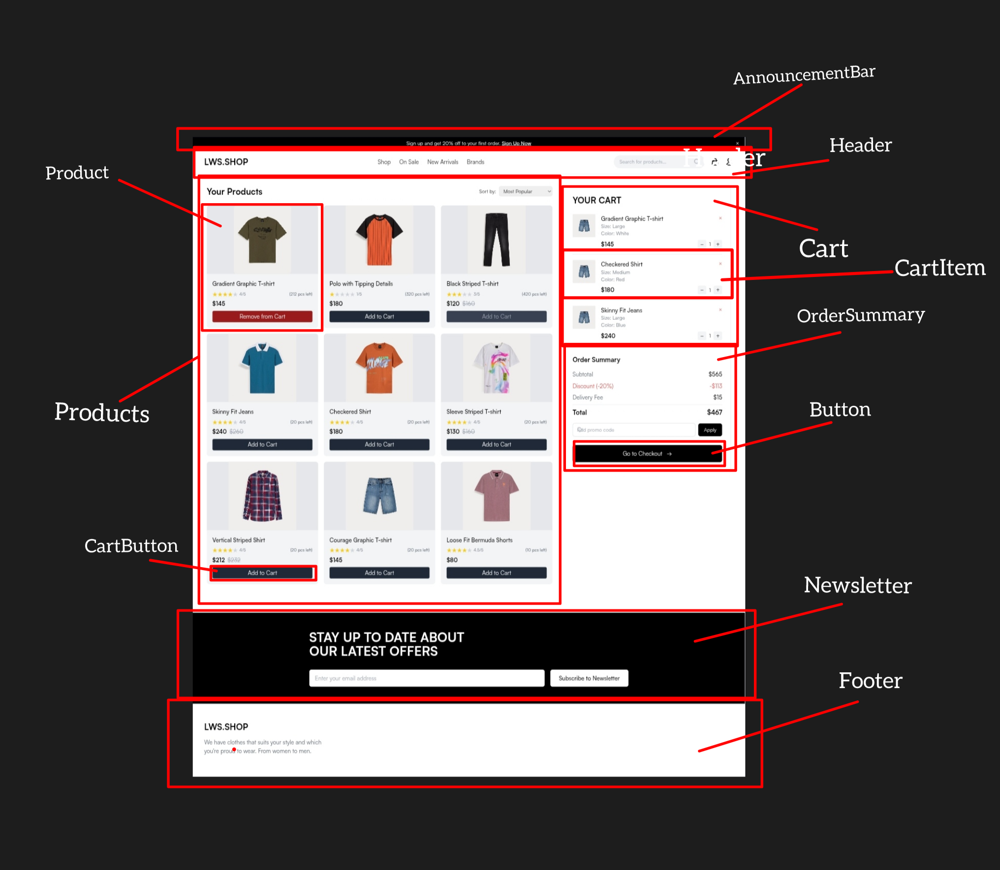

# LWS Shop

LWS Shop একটি React ভিত্তিক ই-কমার্স ফিচার ডেমো প্রজেক্ট, যেখানে বিভিন্ন প্রোডাক্টকে ডাইনামিকভাবে দেখানো, কার্ট ম্যানেজমেন্ট, স্টক কন্ট্রোল, সার্চ ও সোর্টিং ফিচার সহ একটি পূর্ণাঙ্গ শপিং ইন্টারফেস তৈরি করা হয়েছে।


## Features

1. **Dynamic Product Rendering**
   হোমপেজ সেকশনে ডামি `Array of Object` থেকে ডেটা নিয়ে প্রতিটি প্রোডাক্ট কার্ডে নাম, প্রাইস, স্টক, ইমেজ ও বাটনসহ প্রোডাক্ট রেন্ডার করা হয়েছে।

2. **Add to Cart / Remove from Cart**
   "Add to Cart" বাটনে ক্লিক করলে প্রোডাক্টটি "YOUR CART" সেকশনে যোগ হয় এবং বাটনটি "Remove from Cart" এ রূপান্তরিত হয়।

3. **Stock Management**
   যদি কোনো প্রোডাক্টের স্টক 0 হয়, তাহলে সেই প্রোডাক্টে "Add to Cart" বাটন disable হয়ে যায়।

4. **Quantity Increment/Decrement**
   কার্টে থাকা প্রতিটি প্রোডাক্টের পাশে + এবং - বাটন আছে, যা দিয়ে পরিমাণ বাড়ানো/কমানো যায়।

5. **Stock Limitations**
   প্রোডাক্টের পরিমাণ সর্বোচ্চ স্টকের সমান এবং সর্বনিম্ন ১ পর্যন্ত সীমাবদ্ধ করা হয়েছে।

6. **Synchronized Stock Update**
   Quantity বাড়লে মূল স্টক কমে এবং কমলে স্টক বাড়ে। এই স্টক ভ্যালু প্রোডাক্ট কার্ডেও সাথে সাথে আপডেট হয়।

7. **Delete from Cart**
   × বাটনে ক্লিক করে প্রোডাক্টকে কার্ট থেকে রিমুভ করা যায় এবং প্রোডাক্ট কার্ডে বাটন পুনরায় "Add to Cart" হয় ও স্টক রিস্টোর হয়।

8. **Order Summary**
   Subtotal, Discount (20%), Delivery Fee ও রেটিংসহ একটি Order Summary অংশ যুক্ত আছে যেখানে Total Amount ক্যালকুলেট করা হয়।

9. **Sorting Feature**
   প্রোডাক্টগুলোকে Popularity, Newest এবং Price এর ভিত্তিতে সাজানোর Sort অপশন যুক্ত করা হয়েছে।

10. **Search Functionality**
    সার্চ বারে প্রোডাক্টের নাম লিখে অনুসন্ধান করা যায়। যদি কিছু না মিলে তাহলে "Not Found" মেসেজ দেখানো হয়।

## Technologies Used

- React
- Context API
- useReducer
- Vite

## Getting Started

এই প্রজেক্টটি রান করার জন্য নিচের ধাপগুলো অনুসরণ করুন:

```js
# রেপোজিটরি ক্লোন করুন

# ডিরেক্টরিতে যান
cd lws-shop

# প্যাকেজ ইনস্টল করুন
npm install

# প্রজেক্ট রান করুন
npm run dev
```

## File Structure

```js
LwsShop/
├── src/
│   ├── components/
│       ├── Button.jsx
│       ├── CartButton.jsx
│       ├── Footer.jsx
│       ├── Header.jsx
│       ├── Product.jsx
│       ├── Products.jsx
│       ├── Cart.jsx
│       ├── CartItem.jsx
│       ├── Newsletter.jsx
│       ├── OrderSummary.jsx
│       ├── CartAndSummary.jsx
│       ├── AnnouncementBar.jsx
│   └── icons/
│       ├── LwsLogo.jsx
│       ├── PeopleLogo.jsx
│       ├── SearchLogo.jsx
│       ├── ShoppingLogo.jsx
│       ├── TagLogo.jsx
│   └── pages/
│       ├── Homepage.jsx
│   └── context/
│       ├── CartContext.jsx
│       ├── ProductContext.jsx
│   └── reducers/
│       ├── cartReducer.js
│       ├── productReducer.js
│   └── data/
│       ├── initialProducts.js
│   └── utils/
│       ├── getImageLink.js
│   └── App.jsx
│   └── index.css
│   └── main.jsx
│   └── assets/
│       ├── img/
├── public/
└── index.html
└── package.json
└── package-lock.json
└── eslint-config.js
└── vite.config.js
└── README.md
└── .gitIgnore


```

## Component Showcase


